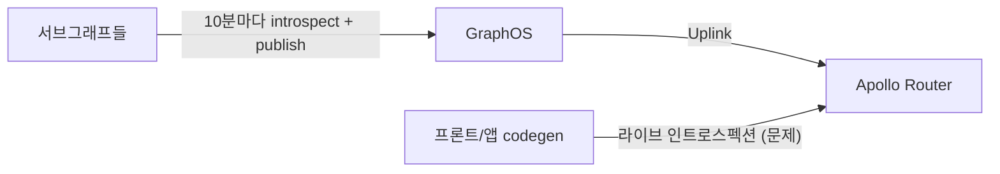
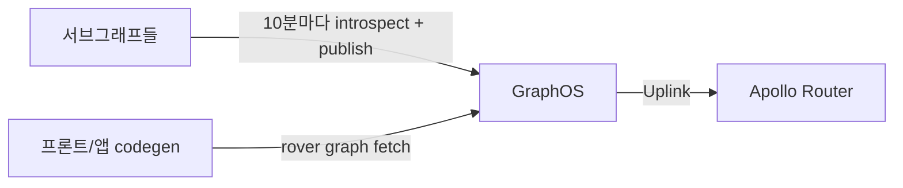

제가 운영하는 GraphQL 게이트웨이는 서브그래프 열다섯 개 남짓을 Apollo Router 하나로 묶어 서빙합니다. 슈퍼그래프 합성은 라우터가 하지 않습니다. CronJob이 10분마다 각 서브그래프에서 `rover subgraph introspect`로 스키마를 뽑아 GraphOS에 publish하고, 라우터는 Uplink로 합성된 결과를 받아 hot reload 합니다. 이 구조로 옮긴 과정은 [Apollo Router 슈퍼그래프, 어디서 합칠 것인가](/series/apollo-router-supergraph-on-kubernetes) 시리즈에 적어 두었습니다.

그 라우터가 개발 환경에서 주기적으로 죽고 있었습니다. 이 글은 원인을 쫓은 기록이고, 결론은 라우터 설정이 아니라 **클라이언트 쪽 codegen이 스키마를 어디서 받느냐**를 바꾸는 쪽으로 났습니다.

## 증상: 4일 사이 OOMKilled 2회

개발 환경 라우터 파드 하나가 3일 23시간 동안 두 번 재시작했습니다. 마지막 종료 사유는 `OOMKilled`, exit code 137이었습니다. 메모리 limit은 1046Mi, request는 523Mi였고, 재시작 직후에 이미 540Mi를 쓰고 있었습니다. 같은 시각 다른 파드는 전부 정상이어서 노드나 클러스터 문제는 아니었습니다.

```
$ kubectl get pod apollo-router-xxxx -o jsonpath='{.status.containerStatuses[0].lastState}'
{"terminated":{"exitCode":137,"reason":"OOMKilled", ...}}
```

재시작 자체는 Deployment가 받아 주니 서비스가 끊기지는 않았습니다. 그런데 "왜 1GiB가 모자라는가"에 답이 없으면 limit을 올려도 같은 일이 더 큰 숫자로 반복될 뿐이라, 거기서 멈추지 않기로 했습니다.

## 원인 추적: 로그의 IntrospectionQuery와 종료 시각이 겹친다

단서는 한 달쯤 전에 적어 둔 메모에 있었습니다. 당시 라우터 메모리가 이상해서 재 본 결과, **인트로스펙션 distinct 쿼리 1건당 라우터 메모리가 약 170Mi 올라가고 내려오지 않았습니다.** 그때 스키마는 타입 3,147개였습니다. 라우터가 인트로스펙션 응답을 쿼리별로 캐시하는데, 스키마가 수천 타입이면 응답 하나가 그 크기가 된다는 뜻입니다.

이번에는 로그로 시간 관계를 봤습니다. 개발 라우터는 `RUST_LOG=apollo_router=debug`라 요청 단위 로그가 남습니다.

- OOM 직전 컨테이너에 남아 있던 로그 228줄(8분 분량)에 `IntrospectionQuery`가 17건. 마지막 줄이 OOM 시각 직전이었습니다.
- 재시작한 새 컨테이너에서도 26분 동안 32건이 들어왔습니다.
- 로그의 `client.name`은 비어 있고 user-agent 필드가 없어, 누가 보냈는지는 로그로는 알 수 없었습니다.

여기서 제 판단을 분명히 적어 두겠습니다. 시간이 강하게 겹치고 앞서 잰 메모리 패턴과 맞아떨어지지만, **이번 OOM이 정확히 이 요청들 때문이라고 증명한 것은 아닙니다.** 단정하려면 인트로스펙션을 끊은 뒤 OOM이 사라지는지를 봐야 하고, 그건 아직 진행 중입니다. 다만 다른 가설이 없었고 조치 비용이 크지 않아 이 가설로 움직였습니다.

라우터 설정을 같이 열어 봤더니, 이미 답이 주석에 적혀 있었습니다.

```yaml
supergraph:
  # 모든 프론트/앱의 graphql-codegen이 개발 라우터에 라이브 인트로스펙션을 보내므로 켜 둠
  introspection: true
```

개발 편의를 위해 켜 둔 기능을 모든 클라이언트 저장소가 라이브로 쓰고 있었고, 그 요청 하나하나가 라우터 메모리에 고정 비용을 남기고 있었습니다. 운영 환경 설정도 `introspection: true`였습니다. 운영 라우터 파드 8개는 재시작 0이었지만, 로그 레벨이 `info`라 인트로스펙션 요청이 몇 건인지 볼 수 없었습니다. 같은 질문에 개발은 답할 수 있고 운영은 답할 수 없었던 것은 설정 차이가 아니라 로그 레벨 차이였습니다.

## 끄기 전에 호출자부터 찾기

`introspection: false` 한 줄이면 끝나는 것처럼 보였습니다. 그런데 그렇게 하면 개발 환경의 codegen이 전부 깨집니다. 어디가 깨지는지 모른 채 끄는 건 장애를 옮기는 일이라, 사내 저장소에서 codegen 설정을 전부 찾아 스키마 출처를 확인했습니다.

개발 라우터를 직접 보는 곳이 11곳이었습니다.

- 주소를 설정에 고정한 곳: Flutter 앱 3개
- 환경변수를 쓰되 기본값이 개발 라우터인 곳: Flutter 앱 2개, 웹 1개
- `.env` 값이 개발 라우터인 곳: 웹 5개

사람이 아닌 호출자도 있었습니다. 한 웹 저장소의 `graphql.config.yml`이 `schema: https://<개발 라우터>`로 되어 있어, IDE의 GraphQL 플러그인이 파일을 열 때마다 라이브 인트로스펙션을 보낼 수 있는 상태였습니다. 로그의 `client.name`이 비어 있던 이유 중 하나일 겁니다.

가장 중요한 발견은 CI였습니다. 그 저장소의 릴리스 워크플로는 `VITE_API_BASE_URL: ${{ secrets.API_BASE_URL }}`로 codegen을 돌리고 있었고, 이 시크릿이 운영 라우터를 가리킬 가능성이 있었습니다. **운영 라우터의 인트로스펙션을 끄려면 이 CI부터 풀어야 한다**는 걸 이 시점에 알았습니다. 호출자를 찾지 않고 설정부터 바꿨다면 릴리스 빌드가 깨졌을 겁니다.

## 선택지 네 개와 결정

| 대안 | 라우터 메모리 | 개발 codegen | 남는 문제 |
|---|---|---|---|
| 1. 라우터 인트로스펙션 끄기 | 해결 | 전부 깨짐 | 호출자 11곳이 멈춤 |
| 2. 메모리 limit 올리기 | distinct 쿼리 수 × 170Mi만큼 필요 | 유지 | 근본 원인 그대로 |
| 3. 인트로스펙션 전용 라우터 분리 | 서빙 라우터는 해결 | 유지 | 파드와 설정이 늘어남 |
| 4. codegen이 GraphOS에서 SDL 받기 | 해결 | 유지 | 클라이언트마다 키 필요 |

4번으로 정했습니다. 결정적인 이유는 하나입니다. **스키마의 진실 공급원이 이미 따로 있었습니다.** 합성과 보관을 GraphOS가 하고 있고, 라우터조차 거기서 받아 쓰고 있는데, codegen이 라우터에서 다시 뽑을 이유가 없었습니다. `rover graph fetch`는 그래프 ref 하나로 합성된 SDL을 내려 줍니다.

전환 전입니다. codegen이 라우터에 라이브 인트로스펙션을 보냅니다.



전환 후입니다. codegen이 GraphOS에서 바로 받고, 라우터에는 요청이 가지 않습니다.



4번 안에서도 두 가지를 비교했습니다.

- A: 개발자가 각자 `schema:pull`을 돌려 로컬에 받는다. 키가 개발자마다 필요하다.
- B: `schema.graphql`을 저장소에 커밋하고 CI가 갱신한다. 키는 CI에만 필요하지만 스키마가 낡을 수 있다.

A로 갔습니다. 팀이 생성물을 저장소에 커밋하지 않는 쪽을 원했기 때문입니다. `generated.ts`가 이미 gitignore였으니 `schema.graphql`도 같은 취급을 받는 게 일관됩니다. 키 배포가 번거롭지만, 그건 한 번이고 낡은 스키마로 빌드되는 사고는 반복됩니다.

## 구현: 웹 저장소 하나에 시범 적용

변경은 다섯 군데입니다.

`scripts/pull-schema.mjs`

```js
import { spawnSync } from "node:child_process";
import { renameSync, writeFileSync } from "node:fs";

const graphRef = process.env.APOLLO_GRAPH_REF || "<개발 그래프>@current";
if (!process.env.APOLLO_KEY) {
  console.error("APOLLO_KEY가 없습니다. docs/codegen.md를 참고해 설정하세요.");
  process.exit(1);
}

const result = spawnSync("pnpm", ["dlx", "@apollo/rover", "graph", "fetch", graphRef], {
  encoding: "utf8",
});
if (result.status !== 0) {
  console.error(result.stderr);
  process.exit(result.status ?? 1);
}

// 실패 시 기존 파일을 비우지 않도록 임시 파일에 쓴 뒤 교체
writeFileSync("schema.graphql.tmp", result.stdout);
renameSync("schema.graphql.tmp", "schema.graphql");
```

임시 파일에 쓰고 rename 하는 건 작은 습관이지만 중요합니다. fetch가 중간에 실패했을 때 `schema.graphql`이 0바이트가 되면 codegen이 이상한 에러로 죽고, 원인을 찾는 데 시간이 듭니다.

`package.json`

```jsonc
"schema:pull": "node scripts/pull-schema.mjs",
"codegen": "pnpm schema:pull && graphql-codegen --config codegen.ts"
```

`codegen.ts`의 `schema`는 라우터 URL에서 `./schema.graphql`로 바꿨습니다. 앱 런타임이 쓰는 `VITE_API_BASE_URL`은 그대로 둡니다. 이 변경은 빌드 시점의 스키마 출처만 바꾸는 것이지 런타임 엔드포인트와는 무관합니다.

`graphql.config.yml`도 `./schema.graphql`로 바꿨습니다. IDE 플러그인이 보내던 라이브 인트로스펙션을 막는 것은 이 한 줄입니다.

워크플로 4개에는 `APOLLO_KEY`와 `APOLLO_GRAPH_REF`를 주입했습니다. 개발 배포와 테스트 워크플로는 개발 그래프, 릴리스 워크플로는 운영 그래프를 봅니다. 앞서 찾은 `secrets.API_BASE_URL` 의존은 이 시점에 사라졌습니다.

검증한 것은 다음과 같습니다.

- 로컬 `pnpm codegen` 성공. `schema.graphql` 약 3.6MB, `generated.ts` 약 4.4MB. 둘 다 `git status`에 나타나지 않음.
- PR의 CI codegen 통과.
- 릴리스 워크플로(운영 그래프 codegen)는 머지·릴리스 후에야 돌기 때문에 아직 확인하지 못했습니다.

`rover` 설치는 사실상 필요 없습니다. 스크립트가 `pnpm dlx @apollo/rover`로 받아 쓰고, 개발자가 직접 쓸 때만 `brew install rover`면 됩니다.

## 막힌 곳: Variant API Key는 플랜이 막았다

처음에는 Variant API Key를 만들어 변종(variant) 단위로 권한을 좁히려 했습니다.

```
NOT_ALLOWED_BY_USER_ROLE: Organization's plan does not support variant key creation
```

플랜이 안 됩니다. 그런데 돌아보니 우리 개발·운영은 한 그래프의 변종이 아니라 **그래프 자체가 둘**이었습니다. 그래서 그래프별 Graph API Key 두 개로 나눴고, 두 키 모두 `rover graph fetch`가 성공했습니다. 키 배치는 이렇게 했습니다.

- 로컬 `.env`: 개발 키만
- GitHub 시크릿 `APOLLO_KEY`: 저장소 수준은 개발 키, environment `production`은 운영 키. 같은 이름이면 environment 시크릿이 저장소 시크릿보다 우선합니다.

이 키가 읽기 전용인지는 아직 확인하지 못했습니다. 그리고 한 가지 운영 실수를 적어 둡니다. 작업 중에 키를 채팅에 그대로 붙여 넣어 노출됐습니다. 키는 환경변수와 시크릿 저장소로만 다루고, 노출되면 교체합니다. 교체는 후속 목록에 들어가 있습니다.

## 나머지 저장소로 확산

시범 저장소 하나로는 라우터 OOM이 멈추지 않습니다. 11곳이 전부 옮겨야 합니다.

- 팀 채널에 변경 이유, 개발자가 할 일 3단계, 참고 링크를 공지했습니다.
- 나머지 저장소에 이슈 9건을 만들었습니다. 웹 4곳, Flutter 5곳. 한 곳은 archived라 이슈를 만들 수 없었습니다(`Repository was archived so is read-only`).
- 웹과 Flutter는 설정 방식이 달라 이슈 본문을 둘로 나눴습니다. Flutter는 스키마 다운로드 스크립트 기준으로 썼고, 각 저장소의 Makefile이나 CI 호출은 보지 못했습니다.

확산이 끝나기 전까지 개발 라우터 OOM은 재발할 수 있습니다. 이건 그냥 받아들이기로 했습니다. limit을 임시로 올리는 것도 생각했지만, 그러면 "아직 안 옮긴 저장소"를 찾을 압력이 사라집니다.

## 현재 상태 점검에서 같이 본 것

전환하면서 GraphOS 쪽이 믿을 만한지도 같이 봤습니다. codegen의 진실 공급원을 옮기는 것이니, 거기가 낡아 있으면 의미가 없습니다.

- publish CronJob 최근 실행은 개발·운영 모두 성공. 서브그래프별 `Failed to publish` 없음.
- 과거 실패 Job이 개발 3건, 운영 3건 남아 있었습니다. 확인할 수 있던 운영 2건은 서브그래프 조회 시 `ECONNREFUSED`로 일시 실패했고 다음 실행에서 복구됐습니다.
- GraphOS SDL: 개발 3.65MB에 타입 3,586개, 운영 3.41MB에 타입 3,365개. 개발에만 있는 타입 234개, 운영에만 있는 타입 13개. 운영에만 있는 13개가 의도된 것인지는 확인하지 못했습니다.
- CronJob 실패 알림은 없습니다. 실패해도 SDL이 최대 10분 더 낡을 뿐이라 급하지 않다고 판단했습니다.

한 달 전 3,147개였던 타입이 3,586개가 됐습니다. 요청당 170Mi도 그만큼 더 커졌을 겁니다. 다시 재지는 않았습니다.

## 한계와 다음

증명하지 못한 것부터 적습니다. "원인은 인트로스펙션"은 시간 상관과 한 달 전 측정에 기댄 추정입니다. 11곳 전환이 끝나고 OOM이 사라지는 것을 봐야 단정할 수 있습니다. 숫자(170Mi, 타입 3,586개)는 우리 환경의 2026년 11월 값이고, 스키마 크기에 비례할 테니 다른 환경에서는 다를 겁니다.

남은 일은 다음과 같습니다.

1. 시범 PR 머지 후 운영 라우터 `introspection: false` 적용. ConfigMap이 디렉터리로 마운트되고 `APOLLO_ROUTER_HOT_RELOAD=true`라 재시작 없이 반영될 가능성이 높지만, 적용해서 확인하지는 않았습니다.
2. 나머지 9곳 전환.
3. 개발 라우터는 `APOLLO_ROUTER_DEV_MODE=true`라 설정에서 인트로스펙션을 꺼도 dev 모드가 다시 켤 수 있습니다. 적용해 보지 않았고, 따로 정리해야 합니다.
4. 노출된 API 키 2개 교체와 읽기 전용 여부 확인.
5. CronJob 실패 알림을 둘지 검토.

이번 일에서 남긴 것은 세 가지입니다. 인트로스펙션은 공짜가 아니고, 스키마가 수천 타입이면 요청 하나가 고정 비용이 됩니다. 스키마의 진실 공급원이 이미 있으면 다른 곳에서 다시 뽑지 않습니다. 그리고 설정 한 줄로 끌 수 있는 것일수록, 끄기 전에 호출자를 전부 찾습니다. IDE 설정 파일과 CI 시크릿도 호출자였습니다.

## Reference

- [Apollo Router: Introspection](https://www.apollographql.com/docs/graphos/routing/configuration#introspection)
- [Rover CLI: `rover graph fetch`](https://www.apollographql.com/docs/rover/commands/graphs#graph-fetch)
- [GraphQL Code Generator: Schema configuration](https://the-guild.dev/graphql/codegen/docs/config-reference/schema-field)
- [GitHub Actions: Using environments for deployment](https://docs.github.com/en/actions/deployment/targeting-different-environments/using-environments-for-deployment)
