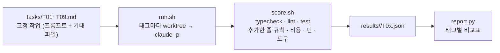

이 시리즈의 모든 수치는 한 장치에서 나왔습니다. 저장소의 `harness/eval/`입니다. 이번 편은 그 장치 자체를 다룹니다. 어떻게 설계했고, 어디서 틀렸고, 다섯 층을 한 표에 놓으면 무엇이 보이는지.

## 설계

목표는 "하네스 층을 하나 올릴 때 같은 작업이 어떻게 달라지는가"를 사람 판정 없이 재는 것입니다. 네 가지로 이뤄집니다.



**고정 작업.** 프롬프트와 기대 산출물(바뀌어야 할 파일)을 frontmatter에 적은 마크다운입니다. 9개이고, 성격이 다릅니다.

| ID | 작업 | 성격 |
|---|---|---|
| T01 | 열 "검토" 추가 | 절차 따르기 (네 곳 수정) |
| T02 | Badge 컴포넌트 추가 | 절차 따르기 (export·테스트·토큰) |
| T03 | 문구 변경 | i18n 대칭 |
| T04 | 완료 요약 줄 추가 | 토큰·문구 규칙 |
| T05 | "왜?" 질문 | 결정 기록 조회 |
| T06 | 파란 배너 추가 | 색 값 유혹 |
| T07 | 안내 문구 변경 | 리터럴 유혹 |
| T08 | 열 식별자 변경 + 저장 데이터 마이그레이션 | 여러 파일 가로지름 |
| T09 | 저장 형식 버전 도입 | 하위 호환·오류 처리 |

**격리 실행.** `run.sh`가 작업마다 git worktree를 만들고 `claude -p`(헤드리스)로 돌립니다. `--dangerously-skip-permissions`는 worktree 안에서만 의미가 있고, 끝나면 worktree를 지웁니다. 비교 대상인 "층"은 git 태그라서, `--ref before`와 `--ref after-hooks`는 같은 작업을 다른 CLAUDE.md·Skill·Hook 구성에서 돌리는 것이 됩니다.

**자동 채점.** `score.sh`가 다섯 가지를 봅니다.

1. `nx run-many -t typecheck lint test` 종료 코드와 오류 수
2. 추가한 줄의 규칙 위반 (`harness/rules_diff.py`)
3. 기대 파일이 바뀌었는지, 질문 작업이면 기대 용어가 답에 있는지
4. 비용·턴 수 (`claude -p`의 result 이벤트)
5. 도구 사용 횟수 (stream-json의 `tool_use` 블록)

통과는 1~3이 전부 깨끗할 때입니다. 사람이 "잘 짰다"를 판정하는 항목은 없습니다. 그래서 "통과했지만 코드가 이상한" 경우를 못 잡고, 반대로 "lint 하나 때문에 실패"가 생깁니다. 둘 다 받아들였습니다. 판정 기준이 고정돼야 층 사이 비교가 됩니다.

## 채점기가 틀린 세 번

채점기도 코드라 틀립니다. 이 시리즈를 쓰는 동안 세 번 고쳤고, 각각이 결과를 바꿨습니다.

**1. 규칙 검사를 파일 전체에 돌렸다.** 에이전트가 손대지 않은 줄의 위반이 에이전트 탓으로 잡혔습니다. `git diff -U0`에서 추가된 줄 번호를 모아 그 줄만 보도록 바꿨습니다. 쓰기 도구와 무관하게 결과만 보는 이 검사기는 [3편](/blog/coding-agent-harness-hooks-bypass)의 Hook에 그대로 들어갔습니다.

**2. `margin: 0`을 간격 하드코딩으로 잡았다.** [1편](/blog/coding-agent-harness-rules-skills-decisions)의 after-rules T04가 이것 때문에 한 번 실패했습니다. `0`은 간격이 아니라 리셋이라 규칙을 고쳤습니다. 결과를 보고 규칙을 고치는 것은 조심해야 하지만, 규칙의 의도에 `0`이 들어가지 않는 것은 분명했습니다.

**3. lint 오류 수가 항상 0이었다.** `nx lint` 출력에 색상 코드(ANSI)가 섞여 정규식이 안 걸렸습니다. 종료 코드로 통과·실패는 맞게 판정했지만 "오류 몇 개"가 0으로 기록됐습니다. 색을 벗기고 다시 셌습니다. 이 버그가 아니었으면 T09의 실패 원인(빈 화살표 함수의 `no-empty-function`)을 로그를 열어 보기 전까지 몰랐을 것입니다.

세 번 모두 "결과가 이상하다 → 로그를 연다 → 채점기가 틀렸다"였습니다. 채점기를 믿지 않고 실패 하나하나의 원인을 열어 본 것이 이 세트를 쓸 만하게 만들었습니다.

## 다섯 층을 한 표에

```
for ref in before after-rules after-hooks-pre after-hooks after-agents; do
  harness/eval/run.sh --ref $ref --run $ref
done
python3 harness/eval/report.py harness/eval/results/{before,after-rules,after-hooks-pre,after-hooks,after-agents}
```

| 층 (태그) | 통과 | 규칙 위반 | 턴 합 | 비용 합 | Bash / Edit·Write | Hook 차단 |
|---|---|---|---|---|---|---|
| before (123줄 한 파일) | 9/9 | 0 | 56 | $1.21 | 33 / 8 | — |
| after-rules (29줄 + Skills + decisions) | 9/9 | 0 | 72 | $1.14 | 33 / 4 | — |
| after-hooks-pre (Write/Edit 차단만) | 8/9 | 0 | 60 | $1.29 | 51 / 8 | 0 |
| after-hooks (+ 변경 줄 검사, Stop) | 8/9 | 0 | 61 | $1.06 | 31 / 7 | 0 |
| after-agents (+ 서브에이전트 2) | 8/9 | 0 | 69 | $1.15 | 40 / 6 | 1 |

작업별 표는 저장소의 `report.py`가 만듭니다. 실패 3건은 전부 같은 종류입니다. T04(after-hooks-pre)와 T09(after-hooks, after-agents)에서 에이전트가 쓴 테스트의 빈 화살표 함수가 eslint 오류를 냈고, 에이전트는 테스트는 돌렸지만 lint는 안 돌렸습니다. 규칙 위반이나 타입 오류로 실패한 작업은 없습니다.

## 이 표가 말하는 것

**품질은 층과 무관하게 거의 같습니다.** 9개 작업에서 규칙 위반은 모든 층에서 0이고, 통과율 차이는 lint 하나입니다. 이 저장소의 규칙은 123줄 한 파일로도 지켜질 만큼 작고 명확합니다. 하네스가 품질을 올렸다고 말할 근거는 이 세트에 없습니다. 그렇게 쓰는 것이 맞습니다.

**비용도 거의 같습니다.** $1.06에서 $1.29 사이이고 순서도 층과 맞지 않습니다. 작업당 10~15센트인 작은 작업에서 규칙 문서 100줄의 차이는 노이즈 안에 있습니다. 규칙 문서가 수백 줄로 자란 저장소에서는 다른 결과가 나오는데, 그건 1편에 적었습니다.

**달라진 것은 측정 가능성입니다.** before 열에는 Hook 차단 칸이 없습니다. 무엇이 걸릴 뻔했는지 알 길이 없습니다. after-hooks부터는 "셸 호출 뒤 검사 9회, 종료 전 검사 8회, 차단 0회"가 숫자로 남고, after-agents에서 색 값 하나가 막혀 토큰으로 바뀐 것도 로그에 있습니다. 하네스가 품질을 올린다는 증거는 못 만들었지만, **품질이 어디서 새는지 볼 수 있는 상태**는 만들었습니다. lint가 Stop 검사에 빠져 있다는 것을 이 표가 알려 줬습니다.

**도구 사용은 층과 무관하게 셸이 많습니다.** 어느 층이든 Bash가 Edit·Write의 4~6배입니다. 3편의 Hook 우회는 특정 층의 현상이 아니라 이 에이전트의 기본 습관입니다. 쓰기 도구에만 거는 검사는 어느 층에서도 대부분을 놓칩니다.

## 세트를 키우려면

- 어려운 작업이 더 필요합니다. T08·T09 같은 여러 파일 작업에서만 층 차이가 날 가능성이 있는데 둘뿐입니다.
- `Stop` Hook에 lint를 넣으면 실패 3건이 사라질 것입니다. 그러면 모든 층이 9/9가 되고, 이 세트는 더 이상 층을 구분하지 못합니다. 그때는 작업을 더 어렵게 만들 차례입니다.
- 같은 작업을 한 번씩만 돌렸습니다. 에이전트 출력에는 분산이 있어서, 작업당 3회 이상 돌려 중앙값을 써야 "6턴 vs 8턴" 같은 차이를 말할 수 있습니다. 비용이 세 배가 되니 작업을 줄이는 것과 맞바꿔야 합니다.

마지막 편은 이 시리즈와, 규칙 문서가 616줄까지 자랐던 다른 저장소에서 배운 것을 묶습니다.

## Reference

- 예제 저장소: [songtomtom/coding-agent-harness](https://github.com/songtomtom/coding-agent-harness) (`harness/eval/`)
- [Claude Code CLI: headless mode (`-p`, `--output-format stream-json`)](https://docs.claude.com/en/docs/claude-code/cli-reference)
