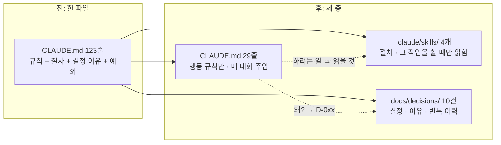

코딩 에이전트에게 프로젝트 규칙을 알려 주는 파일이 있습니다. Claude Code는 `CLAUDE.md`를 매 대화에 그대로 넣어 줍니다. 처음엔 열 줄입니다. "색은 토큰으로", "문구는 i18n으로". 그러다 "열을 추가할 땐 이 네 곳을 고친다" 같은 절차가 들어오고, "지난주에 이렇게 바꾸기로 했다. 이전엔 저랬다"는 결정이 붙고, 예외가 붙습니다. 제가 맡은 저장소 하나는 두 달 만에 96줄에서 616줄이 됐습니다.

문제는 길어진 파일을 에이전트가 다 따르지 않는다는 것입니다. 사람도 그렇습니다. 616줄짜리 규칙을 매번 읽고 일하는 사람은 없습니다. 이 글은 그 파일을 어떻게 나눴고, 나눈 뒤에 무엇이 달라졌는지를 작은 예제 저장소에서 실제로 재 본 기록입니다.

## 한 파일에 세 가지가 섞인다

규칙 파일이 자라는 이유는 성격이 다른 세 가지가 한 곳에 쌓이기 때문입니다.

| 종류 | 예 | 언제 필요한가 |
|---|---|---|
| 행동 규칙 | 색 값을 직접 쓰지 않는다 | 항상 |
| 절차·지식 | 열을 추가하려면 네 곳을 고친다 | 그 작업을 할 때만 |
| 결정과 이유 | 2026-10-02에 없는 키는 키를 돌려주기로 했다, 이전엔 빈 문자열이었다 | "왜?"라고 물을 때만 |

항상 필요한 것은 첫 줄뿐입니다. 나머지 둘은 특정 순간에만 필요한데 매 대화에 전부 주입됩니다. 토큰을 쓰는 것도 문제지만 더 큰 문제는 신호가 묻힌다는 것입니다. 지켜야 할 열 줄이 결정 일지 수백 줄 사이에 흩어져 있으면 에이전트는 그중 몇 개를 놓칩니다.

그래서 셋을 물리적으로 분리하기로 했습니다.



## 예제 저장소

규칙이 저절로 생기는 코드베이스가 필요했습니다. [Nx 모노레포 시리즈](/series/nx-vite-pnpm-monorepo)의 할 일 보드(앱 2개, 라이브러리 3개)에 두 가지를 더했습니다. 색·간격의 단일 출처인 디자인 토큰, 그리고 ko/en 사전과 `t()` 함수가 있는 i18n 라이브러리입니다. 이러면 "토큰 대신 `#2563eb`를 쓰지 않는다", "문구는 `t()`로", "ko와 en 키는 같아야 한다", "열의 순서는 `COLUMNS` 하나" 같은 규칙이 생깁니다.

저장소는 [songtomtom/coding-agent-harness](https://github.com/songtomtom/coding-agent-harness)이고, 태그가 곧 층입니다. `before`는 한 파일, `after-rules`는 세 층입니다.

`before`의 CLAUDE.md는 123줄입니다. 616줄짜리를 본떠 규칙 사이에 절차와 날짜 붙은 결정을 섞어 썼습니다. 일부입니다.

`CLAUDE.md` (before)
```markdown
## 문구 (i18n)

- 사용자에게 보이는 모든 문구는 `@board/i18n` 의 `t("...")` 로 쓴다. ...
- **ko.json 과 en.json 은 키가 완전히 같아야 한다.** `libs/i18n/src/i18n.test.ts` 가 대칭을 검사한다. ...
- 없는 키를 `t()` 로 부르면 키가 그대로 화면에 보인다. 이것은 의도다 — 누락이 숨지 않게(2026-10-02 사용자 결정, 이전엔 빈 문자열을 돌려줬다).

> 테스트에서 문구를 찾을 때는 ko 값으로 찾는다. `setLang('en')` 을 부른 테스트는 끝나기 전에 `setLang('ko')` 로 되돌린다(2026-10-03 사용자 피드백 — 순서에 따라 다른 테스트가 깨졌다).

## 열(Column) 추가 절차

열을 하나 더하면 다음 네 곳을 같이 고친다. ...
1. `libs/board-core/src/board.ts` — `Column` 유니온에 값 추가, `COLUMNS` 에 순서대로 추가.
2. `libs/i18n/src/ko.json`, `en.json` — `column.<값>` 키 둘 다.
...
> 2026-10-05 사용자 결정: 열 추가는 board-core 가 먼저다. 화면에서 열 배열을 따로 들고 있던 적이 있었는데 ...
```

규칙("키가 같아야 한다"), 절차("네 곳을 고친다"), 결정("2026-10-05에 이렇게 정했다, 이전엔 저랬다")이 한 절 안에 있습니다.

## 세 층으로 나누기

### 1. CLAUDE.md에는 행동 규칙만

29줄로 줄였습니다. 남긴 것은 "이렇게 행동하라"뿐이고, 맨 위에 "하려는 일 → 읽을 것" 표를 둬서 절차와 결정이 어디 있는지만 알립니다.

`CLAUDE.md` (after-rules)
```markdown
이 파일은 **항상 지켜야 할 규칙만** 담는다. 절차는 `.claude/skills/`, 결정의 이유와 번복 이력은 `docs/decisions/` 에 있다.

| 하려는 일 | 읽을 것 |
|---|---|
| 열(Column) 추가 | `/add-column` |
| UI 컴포넌트 추가 | `/add-ui-component` |
| 문구 추가·변경 | `/i18n` |
| Nx 명령·테스트 실행 | `/nx` |
| "왜 이렇게 했나" | `docs/decisions/` |

## 규칙

- **색·간격·모서리는 `@board/ui` 의 `tokens` 만.** `#2563eb`, `padding: 12` 같은 값을 직접 쓰지 않는다. ...
- **사용자에게 보이는 문구는 `t("영역.이름")`.** ... ko.json 과 en.json 은 키가 완전히 같아야 한다(`i18n.test.ts` 가 검사). ...
- **board-core 는 순수 함수만.** ... 열의 순서는 `COLUMNS` 하나이고 화면은 이 배열을 돈다 ...
```

처음에는 줄이기만 했다가 에이전트가 절차를 몰라 틀리게 하는 일이 생겨서, 지식을 지우는 게 아니라 **옮기는** 것이라는 쪽으로 방향을 잡았습니다. 아래 두 층이 그 자리입니다.

### 2. 절차는 Skill로

Skill은 Claude Code가 특정 작업을 할 때만 읽는 지시문입니다. 절차 하나가 Skill 하나입니다. 열 추가 절차는 이렇게 옮겨 갔습니다.

`.claude/skills/add-column/SKILL.md`
```markdown
---
name: add-column
description: Use when adding, renaming or reordering a board column (todo/doing/done) in this workspace.
---

# 열(Column) 추가

열은 `libs/board-core` 가 먼저다. 화면은 `COLUMNS` 를 돌며 그리므로 화면 코드는 고칠 것이 없어야 한다(D-004).

1. `libs/board-core/src/board.ts` — `Column` 유니온에 값 추가, `COLUMNS` 에 **순서대로** 추가.
2. `libs/i18n/src/ko.json`, `en.json` — `column.<값>` 키를 둘 다 추가(`/i18n`).
3. `libs/board-core/src/board.test.ts` — 새 열로 `moveTask` 하는 케이스 하나. id 를 넘겨 결정적으로.
4. `pnpm exec nx run-many -t typecheck test` — 화면을 고쳐야 통과한다면 어딘가에 열이 하드코딩된 것이다. 그것을 고친다.
```

`description`에는 **언제 쓰는지만** 적습니다. 절차 요약을 넣으면 에이전트가 본문을 읽지 않고 요약대로 움직이는 일이 생깁니다. 본문 끝의 `(D-004)`는 세 번째 층을 가리킵니다.

### 3. 결정은 파일 하나에 하나

날짜 붙은 결정 10건을 `docs/decisions/`로 옮겼습니다. 결정·이유·이전 방식을 나누고, 번복하면 `supersedes`로 잇습니다.

`docs/decisions/D-004-single-columns-source.md`
```markdown
---
id: D-004
date: 2026-10-05
area: 도메인
status: active
supersedes: []
superseded_by: null
---
# 열의 순서는 COLUMNS 하나다

## 결정
열 배열은 `libs/board-core` 의 `COLUMNS` 한 곳에만 있고, 화면은 이 배열을 돈다.

## 이유
admin 이 열 배열을 복사해 들고 있다가 두 앱이 어긋났다.

## 이전
admin 에 `['todo','doing','done']` 복사본
```

규칙 파일에서 "왜"를 빼면 규칙이 자의적으로 보일 수 있습니다. 그래서 이유를 지우는 대신 ID로 가리킵니다. "왜 이렇게 했나"를 물으면 에이전트가 이 파일을 읽고 답합니다.

## 효과를 재는 장치

나누고 나서 "좋아진 것 같다"로 끝내고 싶지 않았습니다. 같은 작업을 두 태그에서 돌려 비교하는 평가 세트를 저장소에 넣었습니다.

- 고정 작업 5개. 열 추가, UI 컴포넌트 추가, 문구 변경, 요약 줄 추가, 그리고 "왜 이렇게 했나"를 묻는 질문 하나.
- `harness/eval/run.sh`가 작업마다 git worktree를 따로 만들고 `claude -p`로 헤드리스 실행합니다. 에이전트는 그 안에서만 쓰고, 끝나면 지웁니다.
- `score.sh`가 `nx run-many -t typecheck lint test` 종료 코드, 추가한 줄의 규칙 위반, 기대 파일 존재, 비용·턴 수·도구 사용을 기록합니다. 사람 판정은 없습니다.

작업은 이런 모양입니다.

`harness/eval/tasks/T01.md`
```markdown
---
title: 열(Column) "검토" 추가
expect_files: [libs/board-core/src/board.ts, libs/i18n/src/ko.json, libs/i18n/src/en.json, libs/board-core/src/board.test.ts]
---
보드에 "검토(review)" 열을 추가해 주세요. 순서는 doing 과 done 사이입니다. 두 앱 모두에 열이 보여야 하고, 한국어·영어 이름을 모두 준비합니다. 이 저장소의 열 추가 절차를 따릅니다.
```

규칙 위반은 CLAUDE.md의 규칙 중 기계가 판정할 수 있는 것(색 값, 간격 숫자, 한글 리터럴, 상대 경로로 라이브러리 진입, `console.log` 등)을 `harness/rules.py`에 정규식으로 옮긴 것입니다. 에이전트가 **추가한 줄만** 봅니다. 파일 전체를 보면 원래 있던 위반이 에이전트 탓이 됩니다.

## 결과

```
harness/eval/run.sh --ref before --run before
harness/eval/run.sh --ref after-rules --run after-rules
python3 harness/eval/report.py harness/eval/results/before harness/eval/results/after-rules
```

| 작업 | before (123줄) | after-rules (29줄 + Skills + decisions) |
|---|---|---|
| T01 열 "검토" 추가 | ✅ 4턴 · $0.13 | ✅ 6턴 · $0.12 |
| T02 Badge 컴포넌트 추가 | ✅ 3턴 · $0.12 | ✅ 6턴 · $0.12 |
| T03 admin 문구 변경 | ✅ 8턴 · $0.13 | ✅ 11턴 · $0.12 |
| T04 완료 요약 줄 추가 | ✅ 9턴 · $0.17 | ✅ 12턴 · $0.17 |
| T05 규칙의 이유 질문 | ✅ 1턴 · $0.10 | ✅ 3턴 · $0.10 |
| 합계 | 5/5 · 25턴 · $0.66 | 5/5 · 38턴 · $0.62 |

양쪽 모두 타입 오류 0, 린트 0, 테스트 실패 0, 규칙 위반 0입니다.

**비용은 줄지 않았습니다.** 123줄은 매 턴 주입돼도 부담이 작고, 분리하면 Skill을 읽는 턴이 하나씩 추가됩니다(25턴 → 38턴). 이 크기에서 분리는 토큰을 아끼는 수단이 아닙니다. 제가 맡은 616줄짜리 저장소에서는 같은 분리로 같은 작업 비용이 48% 줄었는데, 거기서는 매 턴 616줄이 사라진 효과가 Skill 읽는 비용을 압도했습니다. 분리가 비용으로 이득이 되는 지점은 파일 길이에 달려 있습니다.

**대신 바뀐 것이 둘 있습니다.** 하나는 에이전트가 절차를 **골라 읽는다**는 것입니다. T01은 `add-column`, T02는 `add-ui-component`, T03과 T04는 `i18n` Skill을 스스로 호출했습니다. 작업 5개 중 4개에서 맞는 절차를 찾아 읽었고, 질문만 하는 T05는 아무것도 읽지 않았습니다. 한 파일일 때는 매번 전부를 읽는 것 말고는 선택지가 없습니다.

다른 하나는 "왜"에 대한 답의 근거입니다. T05에서 `before`의 에이전트는 CLAUDE.md의 해당 문장을 인용했고, `after-rules`의 에이전트는 `D-002`, `D-009`를 찾아 결정·이유·이전 방식 순서로 답했습니다. 답의 내용은 같지만 뒤쪽은 출처가 파일 단위로 남습니다. 규칙을 번복할 때 어느 결정을 뒤집는지 적을 자리가 생겼다는 뜻입니다.

## 측정하면서 고친 것

채점기도 틀립니다. 처음 결과에서 `after-rules`의 T04가 규칙 위반 1건으로 실패했는데, 걸린 줄은 `margin: 0`이었습니다. 간격 숫자를 잡는 정규식이 `0`도 잡은 것입니다. `0`은 간격이 아니라 리셋이라 규칙을 고쳤고, 고친 뒤에는 양쪽 다 5/5입니다. 결과를 보고 규칙을 고치는 것은 조심해야 하지만, 이 경우는 규칙의 의도("토큰 대신 숫자를 쓰지 마라")에 `0`이 들어가지 않는 것이 분명했습니다. 글에 적는 이유는 이런 보정이 있었다는 사실 자체가 수치의 일부이기 때문입니다.

## 한계와 다음 편

작업이 5개뿐이고 전부 작습니다. 123줄 규칙으로도 에이전트가 다 지켰으니, 이 세트로는 "분리가 품질을 올린다"는 말을 할 수 없습니다. 품질 차이는 규칙이 더 길거나 작업이 여러 파일을 가로지를 때 나타날 수 있고, 그런 작업을 세트에 더 넣어야 합니다.

그리고 도구 사용 열을 보면 에이전트가 파일을 고칠 때 편집 도구(Edit)보다 셸(Bash)을 훨씬 많이 썼습니다. 지금은 아무 문제가 없지만, 다음에 "쓰기 직전에 금지 패턴을 막는" Hook을 편집 도구에 걸면 이 습관이 문제가 됩니다. 셸로 쓰면 Hook이 발동하지 않습니다. 이 이야기는 Hook 편에서 합니다.

2편은 절차형 Skill입니다. 지식을 옮기는 것을 넘어, 승인 게이트와 안전 규칙이 있는 다단계 작업(브라우저 수동 테스트 세션)을 Skill 하나로 만드는 과정입니다.

## Reference

- 예제 저장소: [songtomtom/coding-agent-harness](https://github.com/songtomtom/coding-agent-harness) (`before`, `after-rules` 태그)
- [Claude Code: Skills](https://docs.claude.com/en/docs/claude-code/skills)
- [Claude Code: CLAUDE.md와 메모리](https://docs.claude.com/en/docs/claude-code/memory)
- 출발점 코드베이스: [Nx + pnpm 모노레포 시리즈](/series/nx-vite-pnpm-monorepo)
