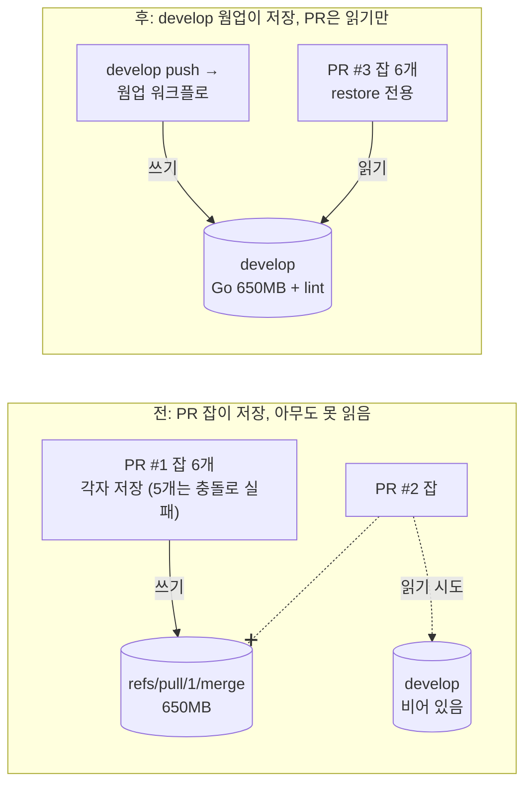

제가 맡고 있는 Go 모노레포에는 서비스가 16개 있고, 서비스마다 PR 워크플로가 따로 있습니다. 그중 가장 큰 서비스의 PR CI가 30분에서 70분 사이를 오갔습니다. 측정을 시작한 날 아침의 기준 실행은 43분이었습니다. PR을 올리고 점심을 먹고 와도 안 끝나는 날이 있었고, 리뷰어는 "CI 통과하면 보겠다"고 하니 리뷰가 하루씩 밀렸습니다.

한 달 전에도 같은 문제를 손댄 적이 있습니다. 그때는 PR 4개로 28분을 13분까지 줄였는데, 다음 날 전부 되돌렸습니다. 이 글은 그 실패를 포함해, 하루 동안 다시 뜯어본 과정입니다. 숫자는 전부 GitHub Actions 실행 로그에서 읽은 값이고, 측정은 각 구성마다 한 번씩이라 몇 분 정도의 편차가 있습니다.

## 환경

- 러너는 `ubuntu-latest`, 2코어에 메모리 7.9GB입니다.
- 대상 서비스는 패키지가 111개입니다. ent, gqlgen, protobuf로 만드는 생성 코드를 git에 커밋하지 않고 CI에서 매번 생성합니다.
- 테스트는 패키지를 5개 그룹(`cmd`, `repository`, `service`, `graph`, `rest`)으로 나눈 matrix 잡이고, 린트 잡까지 러너 6개가 각자 코드를 생성합니다.
- Docker 빌드는 린트와 테스트가 전부 끝난 뒤 `needs`로 이어집니다.
- 저장소의 Actions 캐시 한도는 기본값 10GB입니다.

## 어디서 시간이 가는지부터 셌습니다

처음 가정은 "테스트가 많아서 느리다"였습니다. 잡 단위 시간을 보면 그렇게 보입니다.

| 잡 | 소요 | 그중 |
|---|---|---|
| 린트 | 13.8분 | 코드 생성 4.9분, golangci-lint 7.0분 |
| 테스트 `rest` | **35.3분** | 코드 생성 4.6분, `go test` **27.2분** |
| 테스트 `repository` | 16.0분 | 코드 생성 5.0분, `go test` 7.2분 |
| 테스트 `cmd` | 15.6분 | 코드 생성 5.2분, `go test` 8.3분 |
| 테스트 `graph` | 15.4분 | 코드 생성 5.0분, `go test` 8.3분 |
| 테스트 `service` | 11.3분 | 코드 생성 3.4분, `go test` 6.0분 |
| Docker 빌드 | 7.9분 | `rest`가 끝난 뒤 시작 |

`rest` 그룹의 `go test` 27분이 전체를 정합니다. 그런데 `-v` 로그를 열어 보니 테스트 자체는 패키지당 1~2초였습니다. 대신 한 패키지의 결과가 찍히고 다음 패키지 결과가 찍히기까지 **15분의 공백**이 있었습니다. 그 사이 러너는 테스트를 돌리는 게 아니라 컴파일하고 있었습니다. `go test`는 패키지마다 테스트 바이너리를 빌드하고 링크하는데, 이 서비스는 생성된 ent 코드가 크고, 그걸 `-race`로 컴파일하면 보통 빌드보다 훨씬 느립니다. 게다가 캐시 단계가 2~3초 만에 끝났습니다. 6개 잡 전부 "Cache not found"였습니다. 매 실행이 cold였던 겁니다.

정리하면 43분의 정체는 이랬습니다.

- 잡 6개가 각자 코드 생성에 5분씩 씁니다.
- 생성된 코드를 `-race`로, 캐시 없이, 2코어에서 컴파일합니다.
- 그것도 `-p 1`로 직렬입니다.

`-p 1`은 저희가 한 달 전에 직접 박아 넣은 값입니다. `-race` 테스트 바이너리는 링크할 때 1.5~2GB를 쓰는데, 2코어 러너에서 두 개가 겹치면 7.9GB를 넘겨 러너가 출력 한 줄 없이 `exit 143`으로 죽었습니다. 그래서 그룹을 나누고 링크를 직렬화한 것이었는데, 그 직렬 링크가 이제 가장 긴 구간이 된 셈입니다.

## -race 실험 세 번

`-race`가 범인이라는 건 가설이었으니 실험 PR을 하나 만들어 구성만 바꿔 가며 돌렸습니다.

| 구성 | 전체 | 메모 |
|---|---|---|
| 기준: 전부 `-race -p 1` | 43분 | |
| `-race` 제거, 전체 `-p 2` | 12분에 **실패** | `rest`가 `config` 패키지를 링크하다 메모리 초과(`exit 143`) |
| `-race` 제거, `rest`만 `-p 1` | **18분** | `rest` 9.6분, 나머지 그룹 2~4분, Docker 8분 |
| `repository`·`service`만 `-race` 유지 | 15분 | `rest` 14분. Docker가 28초였는데 이 실행만 Docker 캐시가 우연히 맞았음 |

두 번째 줄이 재미있습니다. `-race`를 빼도 `-p 2`에서 죽었습니다. `-race` 없이도 링크 두 개가 겹치면 2코어 러너에는 벅찬 패키지가 있다는 뜻입니다. 그래서 `rest`만 `-p 1`을 남기고 나머지 그룹은 `-p 2`로 두는 구성이 됐습니다. 세 번째 줄과 네 번째 줄은 전체 시간이 비슷해 보이지만, 네 번째는 Docker 캐시가 맞은 운이 섞여 있고 `rest`는 오히려 14분으로 늘었습니다. 한 번씩만 잰 측정은 이런 식으로 사람을 속이기 때문에, 구성마다 잡 단위 시간을 같이 봐야 했습니다.

matrix에 병렬 수를 넣는 건 이렇게 생겼습니다.

```yaml
strategy:
  fail-fast: false
  matrix:
    group:
      - { name: cmd,        pkgs: ./cmd/...,                 parallel: 2 }
      - { name: repository, pkgs: ./internal/repository/..., parallel: 2 }
      - { name: service,    pkgs: ./internal/service/...,    parallel: 2 }
      - { name: graph,      pkgs: ./internal/graph/...,      parallel: 2 }
      # rest 는 -p 2 에서 링크가 겹쳐 메모리 초과(exit 143). 1 로 둔다.
      - { name: rest,       pkgs: rest,                      parallel: 1 }
steps:
  - run: go test -v -p ${{ matrix.group.parallel }} -coverprofile=coverage.out $PKGS
```

## -race를 빼도 되는가

여기가 이 글에서 제일 오래 고민한 부분입니다. 한 달 전 이슈를 열 때 저는 "주의" 항목에 **"CI 안전장치를 약화하지 말 것, `-race`는 유지"**라고 직접 적어 두었습니다. 그걸 뒤집는 결정이었습니다.

생각을 바꾼 근거는 이렇습니다.

- 이 서비스의 단위 테스트는 요청 하나를 넣고 결과를 보는 식이라 **동시 상황을 만들지 않습니다.** 고루틴이 하나뿐인 테스트에서 `-race`는 잡을 경합이 없습니다. 비용은 전부 내고 얻는 것은 거의 없는 구성이었습니다.
- 실제 서비스에서 경합은 코드가 잠금과 트랜잭션으로 처리합니다. 그걸 검증하는 테스트는 따로 있습니다. PostgreSQL 컨테이너를 띄우고 같은 문서에 두 요청을 동시에 던져 잠금이 제대로 동작하는지 보는 **통합 테스트**입니다. 이 테스트는 처음부터 `-race` 없이 돌고 있었고, 계속 그렇게 돕니다.
- 동시성 코드가 어디 있는지 `go func`와 `sync` 사용을 grep으로 세어 봤습니다. pubsub과 dataloader, 그리고 `cmd`에 몰려 있었고, `repository`는 둘 다 0, `service`는 `go func` 하나였습니다. 라이브러리 안에서 도는 고루틴은 이 방법으로 안 보이니 완전한 조사는 아닙니다.

야간에 `-race`로 한 번씩 돌리는 워크플로를 둘까도 생각했지만 만들지 않았습니다. 실패해도 아무도 안 보는 야간 잡은 경험상 몇 주 안에 빨간 채로 방치됩니다. 대신 동시성 통합 테스트를 확률적 테스트답게 `-count`를 늘려 반복할지는 선택지로 남겼습니다.

이 결정을 PR 하나로 올려 머지했습니다. 그런데 그 PR의 CI는 **21분**이었습니다. 실험에서 18분이던 것이 늘었고, 린트가 13분, `rest`가 14분이었습니다. 캐시가 또 전부 미적중이었습니다. `-race`를 뺀 뒤에도 남는 시간은 cold 컴파일이었던 겁니다.

## 캐시는 왜 한 번도 맞지 않았나

`gh cache list`로 저장소 캐시를 전부 뽑아 종류별로 더했습니다.

| 종류 | 크기 | 개수 |
|---|---|---|
| buildkit 블롭 (Docker `cache-to: type=gha`) | 4.3GB | 199 |
| Go 모듈·빌드 캐시 (`actions/cache`) | 4.5GB | 7 |
| `setup-go` 자체 캐시 | 1.0GB | 6 |
| trivy DB | 0.8GB | 12 |
| 합계 | **10.5GB** | 220 |

한도가 10GB니 GitHub이 오래된 것부터 계속 지우고 있었습니다. 그 자체는 알고 있던 사실입니다. 한 달 전 되돌린 이유가 바로 이것이었으니까요. 이번에 새로 본 것은 **그 10GB를 누가 채우고, 그걸 누가 읽느냐**였습니다.

### 규칙 하나: 캐시는 자기 ref와 base 브랜치 것만 읽는다

GitHub Actions 캐시에는 접근 범위가 있습니다. 워크플로 실행은 자기 ref에 저장된 캐시와, PR이라면 base 브랜치에 저장된 캐시만 읽을 수 있습니다. PR 잡이 끝날 때 저장한 캐시는 `refs/pull/123/merge`에 남고, 그걸 읽을 수 있는 건 **같은 PR의 다음 push뿐**입니다. 새 PR은 `develop`에 저장된 캐시를 찾는데, 저희 워크플로에는 `develop`에 캐시를 저장하는 주체가 없었습니다. `develop`에 push가 일어날 때 도는 건 배포 워크플로뿐이고 그건 Go 빌드 캐시를 만들지 않습니다.



그러니 PR 잡이 열심히 저장한 Go 캐시 4.5GB는 **그 PR이 닫히는 순간 아무도 읽지 않는 데이터**였습니다. 그러면서도 한도의 절반을 차지하고 있었습니다.

### 규칙 둘: Docker gha 캐시도 같은 규칙을 따른다

`docker/build-push-action`에 `cache-to: type=gha,mode=max`를 두면 buildkit 레이어가 Actions 캐시에 저장됩니다. 저희 Docker 빌드는 PR에서 한 번(확인용, push 없음), 태그를 푸시할 때 한 번(배포) 돕니다. 둘 다 `develop` ref가 아닙니다. 그래서 `develop`에 남은 buildkit 캐시는 3MB였고, 나머지 4.3GB는 PR ref와 태그 ref에 흩어져 있었습니다. 다음 PR도, 다음 태그도 그걸 읽을 수 없습니다. **실행마다 600MB를 쓰기만 하고 한 번도 읽히지 않는 캐시**가 전체의 40%였습니다.

### 규칙 셋: 같은 키로 동시에 저장하면 하나만 산다

잡 6개가 같은 키로 캐시를 저장하려고 하면 먼저 끝난 하나만 성공하고 나머지는 "already exists"로 실패합니다. 실패하는 데도 압축과 업로드 시간 30~40초가 잡마다 듭니다. 로그에서 6개 잡 중 5개가 매번 이렇게 끝나고 있었습니다.

## 적용한 것

세 가지를 PR 세 개로 나눠 순서대로 머지했습니다.

**1. 아무도 안 읽는 저장을 끊기.** 워크플로 56개에서 `cache-to`를 지우고 `cache-from`만 남겼습니다. `actions/cache`로 Go 캐시를 이미 다루는 33개 파일에서는 `actions/setup-go`의 자체 캐시를 껐습니다. 이 PR은 속도를 올리지 않습니다. 쓰기만 끄는 것이라 머지 직후 사용량이 10.5GB에서 9.8GB로 내려갔을 뿐입니다. 하지만 이걸 먼저 하지 않으면 다음 단계가 또 밀려납니다.

```yaml
- uses: actions/setup-go@v5
  with:
    go-version-file: go.mod
    cache: false          # 아래 actions/cache 와 중복. ref 마다 176MB 더 저장하던 것

- uses: docker/build-push-action@v6
  with:
    push: false
    cache-from: type=gha
    # cache-to 없음. PR/태그 ref 에만 저장돼 다른 실행이 읽지 못한다.
```

**2. `develop`에 캐시를 채우는 웜업 워크플로.** `develop`에 해당 서비스 경로가 바뀐 push가 들어오면 돕니다. 코드 생성 → `go build ./...` → 테스트를 **실행하지 않고 컴파일만** → golangci-lint 순서입니다.

```yaml
on:
  push:
    branches: [develop]
    paths: ["services/foo/**", "shared/**", ".github/workflows/foo-go-cache-warm.yaml"]
  workflow_dispatch:

jobs:
  warm:
    runs-on: ubuntu-latest
    steps:
      - uses: actions/checkout@v4
      - uses: actions/setup-go@v5
        with: { go-version-file: go.mod, cache: false }
      - uses: actions/cache@v4
        with:
          path: |
            ~/.cache/go-build
            ~/go/pkg/mod
          # PR 워크플로의 복원 키와 형식이 같아야 한다.
          key: ${{ runner.os }}-go-foo-${{ hashFiles('**/go.sum') }}-${{ hashFiles('services/foo/**/*.go', 'shared/**/*.go') }}
          restore-keys: |
            ${{ runner.os }}-go-foo-${{ hashFiles('**/go.sum') }}-
            ${{ runner.os }}-go-foo-
      - run: make generate
      - run: go build ./...
      # -run '^$' 은 어떤 테스트와도 매치되지 않아 실행 없이 컴파일·링크만 한다.
      # -p 는 PR 워크플로와 같게 둬서 메모리 조건을 맞춘다.
      - run: go test -count=1 -run '^$' -p 1 ./...
      - uses: golangci/golangci-lint-action@v7
        with: { working-directory: services/foo }
```

`go test -run '^$'`가 핵심입니다. 정규식 `^$`는 빈 문자열에만 매치되므로 어떤 테스트 함수 이름과도 맞지 않습니다. `go test`는 그래도 패키지마다 테스트 바이너리를 빌드하고 링크하니, 빌드 캐시에는 PR 테스트가 쓸 것과 똑같은 산출물이 쌓입니다. `-count=1`은 테스트 결과 캐시 때문에 건너뛰는 일을 막습니다.

**3. PR 잡은 읽기만.** `actions/cache@v4`를 `actions/cache/restore@v4`로 바꿨습니다. 키 형식은 웜업과 같고, PR의 소스 해시가 `develop`과 달라도 `restore-keys`의 접두어 폴백으로 가장 최근 `develop` 캐시를 받습니다. 저장을 안 하니 6개 잡의 충돌 저장도 사라집니다.

```yaml
- uses: actions/cache/restore@v4   # 저장하지 않는다. develop 웜업이 저장한 것을 읽기만
  with:
    path: |
      ~/.cache/go-build
      ~/go/pkg/mod
    key: ${{ runner.os }}-go-foo-${{ hashFiles('**/go.sum') }}-${{ hashFiles('services/foo/**/*.go', 'shared/**/*.go') }}
    restore-keys: |
      ${{ runner.os }}-go-foo-${{ hashFiles('**/go.sum') }}-
      ${{ runner.os }}-go-foo-
```

웜업 첫 실행은 cold라 15분이 걸렸고, Go 캐시 650MB가 `develop` ref에 저장된 것을 확인했습니다. 두 번째 실행은 자기 캐시를 이어받아 5분이었습니다.

## 결과

웜업이 한 번 돈 뒤 새 PR을 열어 쟀습니다.

| 단계 | 전체 | 린트 | `rest` | 코드 생성(잡당) |
|---|---|---|---|---|
| 기준 (`-race -p 1`) | 43분 | 13.8분 | 35.3분 | 약 5분 |
| `-race` 제거, 캐시 미적중 | 21분 | 13분 | 14분 | 약 5분 |
| + 캐시 정리 + 웜업 후 새 PR | **15분** | 1.8분 | 7.9분 | 0.5~1분 |

린트가 13분에서 2분이 된 건 golangci-lint 캐시까지 웜업이 채웠기 때문입니다. 코드 생성이 5분에서 1분 아래로 내려온 건 생성 도구 자체가 `~/go/pkg/mod`에서 복원되고 ent 생성기가 쓰는 의존성 컴파일이 캐시되기 때문입니다. 이제 15분 중 7분은 린트·테스트 뒤에 직렬로 붙는 Docker 빌드입니다. 다음 꼬리는 거기입니다.

그 뒤 실제 업무 PR 하나는 벽시계로 21분이 나왔습니다. 잡 자체는 1~10분이었는데 `service` 그룹이 러너 대기열에서 10분을 기다렸습니다. 같은 저장소의 다른 워크플로와 러너를 나눠 쓰니 캐시로는 어쩔 수 없는 변동입니다.

## 한 달 전엔 왜 하루 만에 되돌렸나

9월 말에도 같은 서비스를 28분에서 13분으로 줄였습니다. 코드 생성 결과를 캐시로 공유하고, `paths` 필터를 좁히고, `rest` 그룹을 쪼개고, `develop` 웜업을 넣은 PR 4개였습니다. 다음 날 아침 캐시 사용량이 12GB였고, 밤사이 웜업 캐시가 밀려나 PR은 다시 cold가 됐습니다. 장기 유지가 안 된다고 보고 전부 revert했습니다.

그때는 "캐시가 한도를 넘는다"까지만 보고 "그러니 웜업은 안 된다"로 결론을 냈습니다. 이번에 다른 점은 한도를 넘기는 게 **무엇**인지를 종류별로 센 것입니다. 넘치게 하는 건 웜업이 아니라 아무도 못 읽는 Docker 레이어와 PR ref에 갇힌 Go 캐시였습니다. 그 쓰기를 먼저 끊고 나니 웜업이 들어갈 자리가 생겼습니다. 같은 발상이 한 달 간격으로 한 번은 실패하고 한 번은 됐는데, 차이는 발상이 아니라 순서였습니다.

## 한계와 다음

- 측정은 구성마다 한 번씩입니다. 러너 성능과 대기열에 따라 몇 분씩 움직이는 걸 실험 중에도 봤습니다(`rest` 9.6분이 다른 실행에서 14분).
- 캐시가 한도 안에 머무는지는 한 달쯤 지나야 압니다. 지금은 9.8GB로 한도 바로 아래라, 다른 서비스에 웜업을 넓히면 다시 넘칠 수 있습니다. 서비스마다 650MB를 쓴다면 16개 전부는 못 넣습니다.
- `-race`를 뺀 것은 이 서비스의 테스트 성격을 보고 내린 결정입니다. 단위 테스트가 고루틴을 띄워 동시 호출을 검증하는 코드베이스라면 같은 결정을 하면 안 됩니다.
- Docker 빌드 7분이 이제 직렬 꼬리입니다. 린트·테스트와 병렬로 시작하는 것은 한 달 전 시도에서 효과가 있었으니 다시 가져올 후보입니다.
- 워크플로 58개가 서비스별 복사본이라 이번에도 56개 파일을 한 번에 고쳤습니다. 재사용 워크플로로 합치는 건 별도 작업입니다.
- 2코어 러너에서 cold 컴파일을 하는 구조 자체는 그대로입니다. `GOCACHEPROG`로 원격 빌드 캐시를 두거나, 디스크가 남는 자체 러너를 쓰는 것이 근본 대안이고, 10GB 한도와 싸우는 건 그 전까지의 방편입니다.

## Reference

- GitHub Docs, [Caching dependencies to speed up workflows](https://docs.github.com/en/actions/using-workflows/caching-dependencies-to-speed-up-workflows) — 캐시 접근 범위(자기 ref와 base 브랜치)와 10GB 한도
- [actions/cache](https://github.com/actions/cache) — `restore`·`save` 분리 액션, `restore-keys` 접두어 폴백
- [docker/build-push-action — GitHub Actions cache](https://docs.docker.com/build/cache/backends/gha/) — `type=gha` 백엔드가 Actions 캐시 범위를 그대로 따름
- `go help testflag` — `-run`, `-count`, `-p`, `-race`
- [Go Race Detector](https://go.dev/doc/articles/race_detector) — 메모리 5~10배, 실행 2~20배 비용
