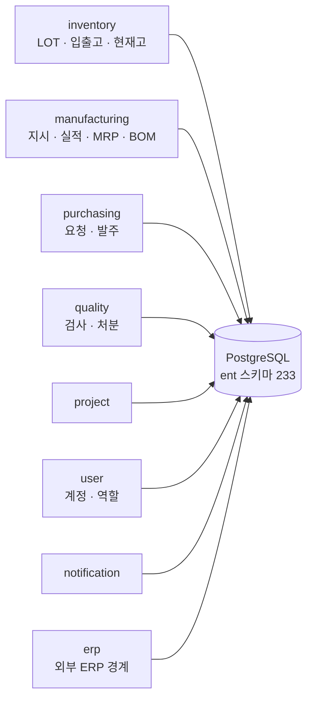
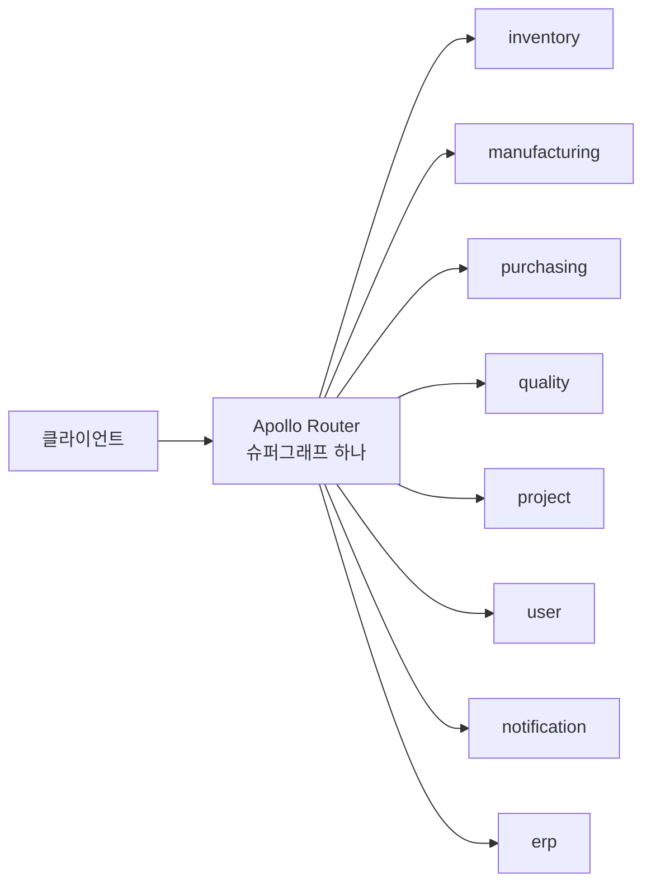
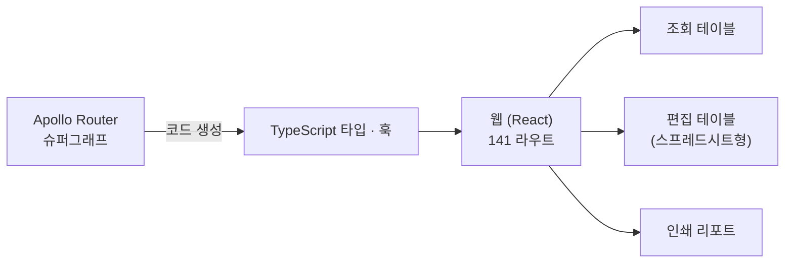
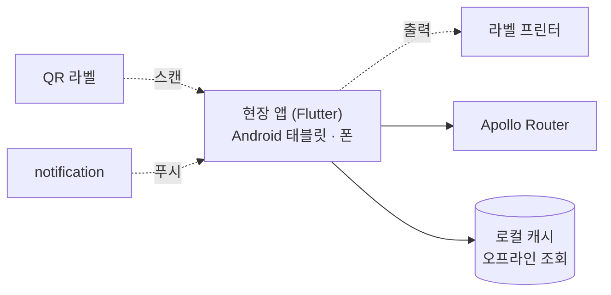
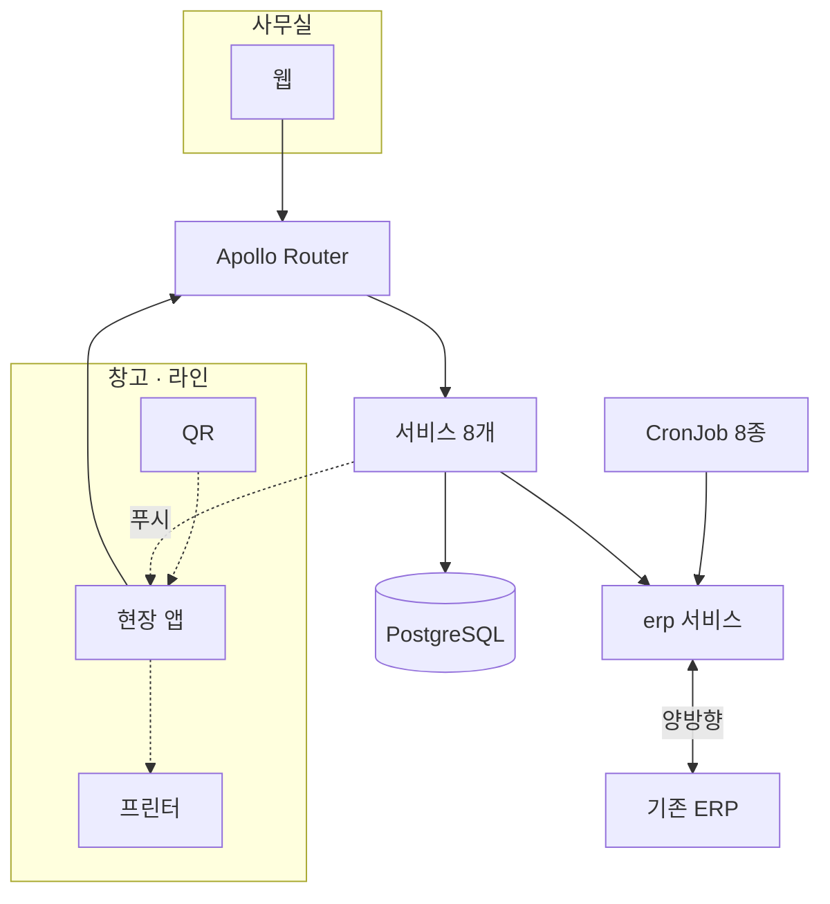
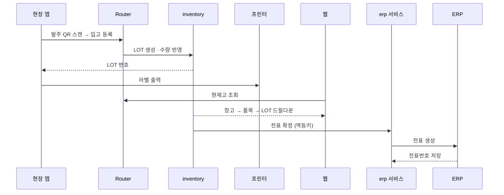
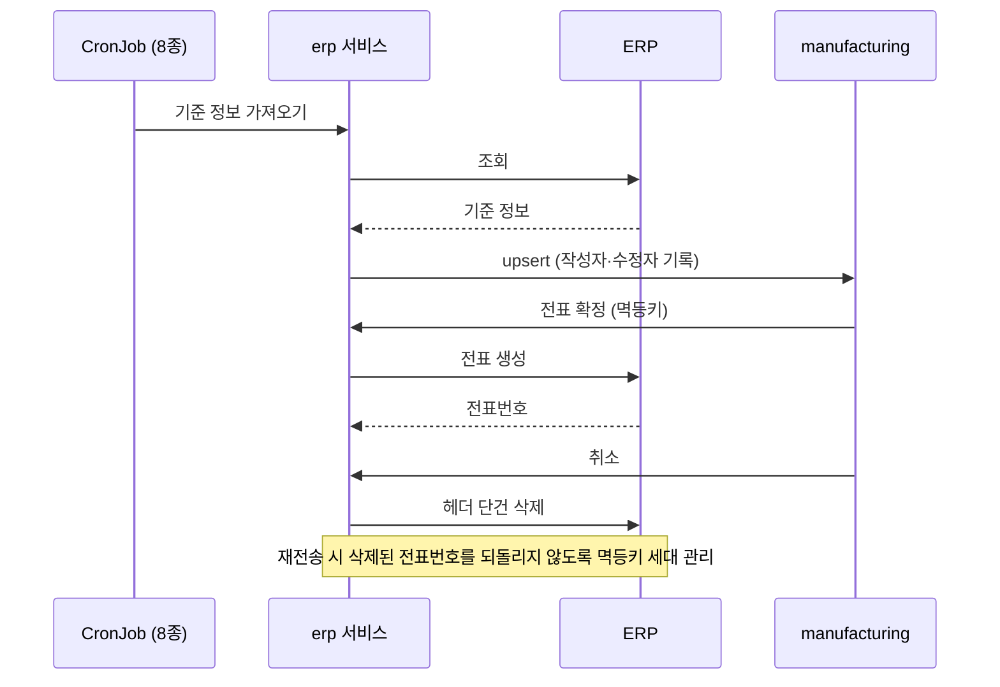
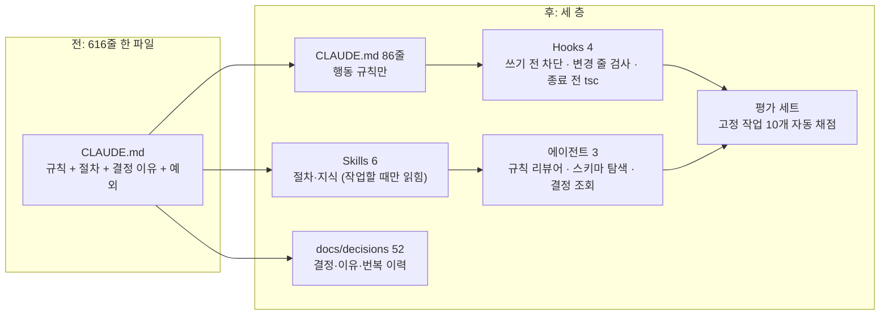

## 내 역할

설계 전체와 백엔드·웹 구현의 대부분을 직접 했고, 현장 앱은 팀원이 주도하고 저는 구조와 리뷰를 맡았습니다. 저장소 기준 기여 비율입니다.

| 영역 | 내 커밋 | 전체 | 비율 | 역할 |
|---|---:|---:|---:|---|
| 백엔드 (Go 서비스 8개) | 2,075 | 2,289 | 90% | 설계·구현 |
| 웹 (React) | 911 | 1,123 | 81% | 설계·구현, PR 393건 중 356건 |
| 현장 앱 (Flutter) | 200 | 680 | 29% | 구조 설계·리뷰, 팀원 주도 |

## 1. 서버: 도메인마다 서비스 하나

생산·재고·구매·품질은 바뀌는 주기도 담당 팀도 다릅니다. 그래서 도메인마다 Go 서비스를 따로 두고, 각 서비스는 자기 테이블만 소유합니다. 이 여덟 개가 시스템의 뼈대입니다.

스키마 233개를 ent로 정의해 Go 타입, DB 마이그레이션, GraphQL 타입이 한 정의에서 나옵니다.

서비스가 여덟 개면 클라이언트가 여덟 군데에 물어야 할 것 같지만 그렇지 않습니다. 각 서비스가 GraphQL 서브그래프를 내고 Apollo Router가 그것을 하나의 슈퍼그래프로 합칩니다. 클라이언트는 라우터 하나만 압니다.

생산지시 화면이 품목(manufacturing)과 현재고(inventory)를 한 쿼리로 받는 식입니다. 조인은 라우터가 합니다.

**왜 하나로 만들지 않았나.** 한 코드베이스였다면 생산 쪽 배포가 재고를 멈추게 했을 것입니다. 나누되 Federation으로 묶어, 운영은 따로 하고 API는 하나로 보이게 했습니다.

## 2. 웹: 사무실에서 보는 화면

웹은 라우터의 슈퍼그래프에서 타입을 생성해 씁니다. 서버 스키마가 바뀌면 웹 빌드가 깨지기 때문에, 141개 화면이 서버와 어긋난 채 배포될 수 없습니다.

141개 화면이 넉 달 안에 나오려면 화면마다 결정을 다시 할 수 없었습니다. 컬럼의 데이터 종류가 표시 방식을 결정하도록 규칙을 문서로 고정했습니다. 날짜는 늘 같은 포맷, 수량은 늘 우측 정렬, 상태는 늘 배지. 예외는 이유와 함께 같은 문서에 남깁니다.

**효과.** 날짜 필드 49곳을 한 커밋으로 바꿀 수 있었습니다. 규칙이 한 곳에 있으니 바꾸는 것도 한 곳입니다.

## 3. 현장 앱: 창고와 라인에서 쓰는 손

창고에는 책상이 없습니다. 스캔, 출력, 확인 세 동작이 한 손으로 끝나야 해서 웹을 반응형으로 늘리는 대신 현장 전용 Flutter 앱을 두었습니다. 앱도 같은 라우터, 같은 생성 타입을 씁니다.

입고 한 건은 앱에서 QR 스캔, LOT 번호 수신, 라벨 출력으로 끝납니다. 부품 적재 위치는 격자로 추적하고 오프라인에서도 조회됩니다.

## 4. 합치면: 입력은 한 번, 나머지는 결과

세 조각을 붙이면 이렇게 됩니다. 어느 입구로 들어오든 같은 서비스가 처리하고 같은 LOT 번호로 추적됩니다. 그리고 기존 ERP가 바깥에 하나 더 있습니다.

현장에서 QR을 한 번 찍으면 어디까지 이어지는지가 이 시스템의 요약입니다.

입력은 현장에서 한 번. 사무실과 ERP는 그 결과를 받기만 합니다. 같은 사실을 두 번 입력하는 지점을 없애는 것이 설계의 기준이었습니다.

## ERP 양방향 동기화

마지막 조각이 가장 어려웠습니다. 기준 정보(품목·BOM 등)는 ERP가 원본이라 가져오고, 현장에서 생기는 전표는 이 시스템이 원본이라 ERP로 보냅니다. 방향이 다른 두 흐름을 각각 설계했습니다.

역동기화는 5단계로 나눠 도입했습니다. 각 단계마다 dev에서 실측 창을 열어 ERP 쪽 결과를 캡처한 뒤 prod로 올렸습니다.

**어려웠던 것.** ERP의 취소·삭제 API가 문서와 다르게 동작해, 실제 호출 결과를 캡처해 맞추는 과정이 필요했습니다. 취소 뒤 재전송이 이미 삭제된 전표번호를 되살리는 결함을 멱등키에 세대를 붙여 막았습니다.

## 도입 과정: 현장 부서가 고객이었다

이 시스템에는 외부 고객이 없습니다. 대신 생산·구매·품질·물류 부서가 고객이었고, 저는 그 현장에 들어가 요구를 받아 시스템으로 옮기는 자리에 있었습니다. 진행은 이렇게 했습니다.

1. **요구는 화면이 아니라 업무 흐름으로 받았습니다.** "이 화면을 만들어 달라"가 아니라 "입고가 들어오면 누가 무엇을 어디에 적는가"를 부서마다 따라가며 적었고, 그 흐름이 서비스 경계(재고·생산·구매·품질·프로젝트)가 됐습니다.
2. **넉 달 동안 전부를 한 번에 열지 않았습니다.** 재고, 구매, 생산·품질, ERP 연동 순서로 열었습니다. 앞 도메인이 뒤 도메인의 입력이 되는 순서라, 매 단계에서 현장이 넣은 실제 데이터로 다음 단계의 스키마를 검증할 수 있었습니다.
3. **현장 피드백이 결정 기록이 됐습니다.** 열고 나면 "이 칸은 필요 없다", "이 순서가 아니다"가 매일 왔고, 두 달 동안 그렇게 바뀐 결정이 40건입니다. 처음엔 규칙 문서 안에 날짜를 붙여 쌓았고, 나중에 결정 하나당 파일 하나(아래 "AI 개발 환경")로 옮겼습니다. 번복된 결정도 지우지 않고 이력으로 남겼습니다.
4. **ERP는 바꿀 수 없는 상대였습니다.** 회계는 ERP를 계속 쓰므로, 현장은 이 시스템만 보고 회계는 ERP만 보게 하는 양방향 동기화가 전제였습니다. 문서와 다르게 동작하는 API는 실제 호출로 캡처해 맞췄습니다(위 "ERP 양방향 동기화").

이 네 가지가 제가 생각하는 Forward Deployed의 일입니다. 모호한 현장 요구를 시스템 경계로 옮기고, 작게 열어 실제 데이터로 검증하고, 바뀐 이유를 기록하고, 바꿀 수 없는 레거시와 정합성을 맞추는 것.

## AI 개발 환경: 규칙 문서가 자라는 문제

이 시스템은 넉 달 동안 저 혼자 백엔드 90%, 웹 81%를 쓰면서 코딩 에이전트를 많이 썼습니다. 그러다 보니 매 대화에 주입되는 프로젝트 규칙 파일이 8월 96줄에서 10월 616줄로 자랐습니다. 두 달 사이 수정 커밋만 108건, "이렇게 하기로 했다(날짜)"는 결정 문장이 40개였습니다. 규칙 문서가 결정 일지가 됐고, 길어질수록 에이전트도 사람도 일부만 따랐습니다.

**결정 1. 규칙·절차·결정을 세 층으로 분리.** 항상 지켜야 할 행동 규칙만 86줄로 남기고, "어떻게 만드는지"는 Skill 6개로 옮겨 그 작업을 할 때만 읽히게 했습니다. 날짜 붙은 결정 52건은 파일 하나당 하나로 분리해 결정·이유·번복 관계를 갖게 했습니다. "왜 이렇게 했나"를 묻는 전용 에이전트가 이 파일들을 읽습니다.

**결정 2. 금지는 글이 아니라 실행 경로에.** 규칙 중 기계가 판정할 수 있는 것을 골라 검사기로 만들고, 파일을 쓰기 직전에 막는 Hook과 작업을 끝내기 전에 타입 검사를 돌리는 Hook을 붙였습니다. 막힌 기록은 로그로 남아 어떤 규칙이 얼마나 자주 걸리는지 셀 수 있습니다.

**결정 3. 효과를 재는 장치를 먼저.** 고정 작업 10개(컬럼 추가, 등록 버튼, 조건 칸 추가, 테스트 작성 등)를 헤드리스 에이전트로 실행하고 타입 오류·린트·관련 테스트·규칙 위반·비용·턴 수를 자동 채점하는 세트를 만들었습니다. 사람 판정은 없습니다. 하네스를 바꿀 때마다 같은 작업을 다시 돌려 비교합니다.

**같은 10개 작업의 전후**

| | 616줄 규칙 문서 | 하네스 적용 |
|---|---|---|
| 비용 | $4.55 | $2.35 (−48%) |
| 통과 | 9/10 | 8/10 |
| 규칙 위반(추가한 줄 기준) | 0 | 0 |
| 기존 테스트 깨뜨림 | 1 | 1 |
| Hook 차단 | — | 종료 전 타입 오류 1회 |

비용이 반으로 준 것은 규칙 축소의 직접 효과입니다. 품질은 이 작업 세트에서는 차이가 없었습니다. 616줄 상태에서도 에이전트는 규칙을 거의 지켰고, 하네스가 품질을 올렸다는 근거는 아직 없습니다. 그렇게 쓰는 게 맞다고 봅니다.

**측정이 가르쳐 준 것.** 첫 측정에서 쓰기 차단 Hook은 0건이었는데, 규칙을 잘 지켜서가 아니라 **발동하지 않아서**였습니다. 에이전트가 파일을 편집 도구 대신 셸(파이썬 히어독, `cat >>`)로 고쳐서 Write·Edit에 건 Hook을 전부 우회했습니다(셸 49회, 편집 도구 4회). 그래서 쓰기 도구와 무관하게 "변경된 줄 전체"를 검사하는 층을 셸 실행 뒤와 종료 시점에 추가했습니다. 채점도 처음에는 파일 전체를 봐서 원래 있던 위반이 에이전트 탓으로 잡혔고, 추가한 줄만 보도록 고쳤습니다. 작업 10개 중 3개는 제가 잘못 설계해(이미 있는 기능, 틀린 전제) 에이전트가 올바르게 멈춘 경우였습니다. 모호한 요구에는 에이전트도 사람처럼 질문하고 멈춥니다.

## 남은 것

- ERP 역동기화의 마지막 단계는 아직 운영 데이터로 검증 중입니다.
- 하네스가 품질을 올리는지는 더 어려운 작업(여러 파일을 가로지르는 어댑터 추가)을 세트에 넣어야 보입니다. 종료 전 Hook에 관련 테스트 실행을 더하는 것이 다음 과제입니다.
- Federation 라우터의 슈퍼그래프 구성 방식을 바꾼 과정은 [Apollo Router 시리즈](/series/apollo-router-supergraph-on-kubernetes)에 따로 정리했습니다.
